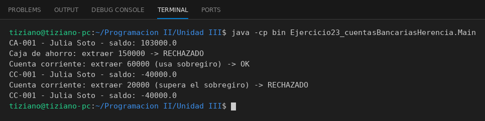

# CuentaBancaria

Programación II - Unidad 3 - Ejercicio 23

## Consigna
Modelar una jerarquía de clases con herencia: una clase base y subclases que reutilizan código con `super` y sobrescriben métodos. Cuentas bancarias especializadas.

## Lógica
- `CuentaBancaria` base con `depositar` y `extraer` y saldo `protected`.
- `CajaAhorro` suma `aplicarIntereses()`.
- `CuentaCorriente` reescribe `extraer` para permitir sobregiro hasta un límite.
- `Main` simula operaciones mixtas.

## Ejecución

